# NotiSift

[](https://github.com/procoder-net/notisift/actions/workflows/ci.yml)
[](https://github.com/procoder-net/notisift/releases/latest)
[](LICENSE)


**An open-source Android app that sorts your notification drawer: what matters stays on top, the noise waits quietly, junk disappears.**

> ### 🤖 An AI decision-model drawer
> Plug in a **decision model** and NotiSift reads each notification the moment it arrives, decides
> **Important, Later or Junk** and picks its group, then rebuilds your drawer around those decisions:
> ⭐ what needs you on top, everything else in quiet **Day → group → notification** stacks.
>
> - **Any model, your key:** Perplexity's decision models, OpenAI, Anthropic, Gemini, OpenRouter, Groq, or a model
>   on your own network (Ollama, LM Studio). Paste one key; the provider is detected for you.
> - **Per notification, not per app:** "show Amazon deliveries, hide Amazon deals" works because each notification
>   is decided on its own.
> - **Your rules always win:** codes, chats, calls and alarms never leave the phone, your choices beat the model,
>   and if the model is slow or unsure the notification simply stays in the drawer.
> - **No AI? Still works.** Built-in on-phone rules make the same decisions offline. The model makes them sharper.
>
> [How the decision model plugs in ↓](#any-decision-model) · [Download the APK](https://github.com/procoder-net/notisift/releases/latest) · [Contribute](#contributing)

NotiSift (*notification + sift*) reads every notification as it arrives and files it into one of three tiers.
It works fully offline with built-in rules, and gets smarter with any AI model you choose (Perplexity, OpenAI,
Anthropic, Gemini, OpenRouter, Groq, or your own Ollama/LM Studio server). Nothing is deleted: everything it moves
stays in the app for as long as you choose.

<p align="center">
  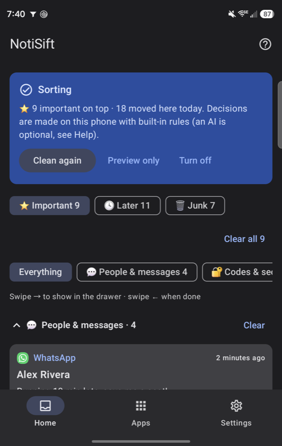
  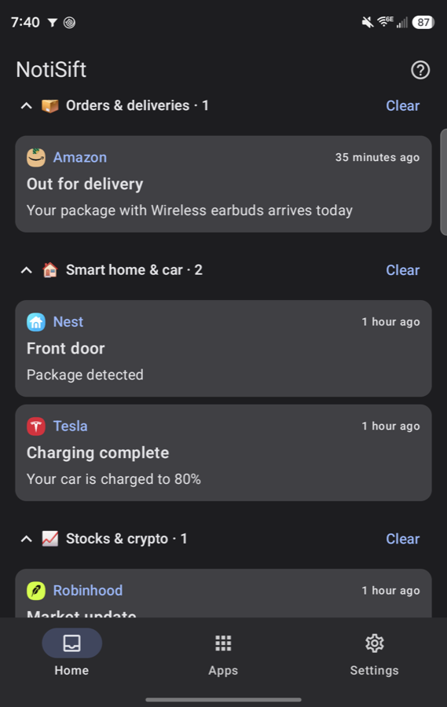
  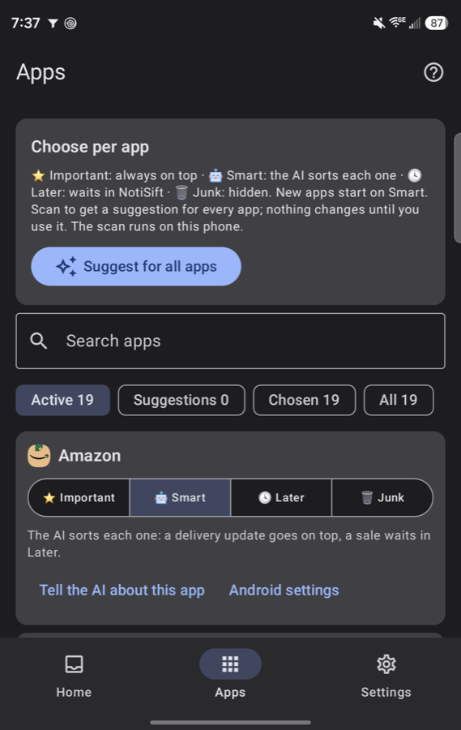
</p>

<sub>All screenshots use the built-in demo data (`assembleDemo`, see below). Every name and message in them is made up.</sub>

## Why

A typical phone gets 50 to 100+ notifications a day, and most of them are not for right now: sales, "people you
may know", feed updates, ride receipts, "rate your visit". The few that matter (a message from a person, a code,
a bill due, a delivery arriving) get buried, so you either clear everything and miss things, or never clear and
stop looking.

Android's own tools are all-or-nothing per app or channel: you can't say "show Amazon deliveries, hide Amazon
deals". NotiSift decides **per notification**, so one app can land in all three tiers.

## What it does

| Tier | What goes there | Where you see it |
|---|---|---|
| ⭐ **Important** | Messages from people, codes, money owed, calls and reminders, deliveries arriving now | Top of your drawer, as working copies of the originals (tap opens the exact chat, reply buttons work) |
| 🕓 **Later** | Useful but not urgent: receipts, news, social activity, smart-home events | One silent row per group in the drawer, and the Home tab |
| 🗑️ **Junk** | Ads, promos, engagement bait, review requests, update nags | Only inside NotiSift, in case you need it |

On top of the tier, every notification gets a **group** (People & messages, Codes & security, Money & bills,
Orders & deliveries, News, Social, Promotions, Smart home & car, Stocks & crypto, Travel, Health, Video & music…),
so the Later pile stays readable instead of being one long list.

### How it helps

- **A short drawer.** Only the few things that need you now sit on top; everything else is one silent row per group.
- **Nothing is lost.** Junk and Later stay in the app (14 days by default). Swipe any one back on top.
- **Chats, not just apps.** A 1:1 chat and a 300-member community group aren't equally urgent. Set any chat to
  *Only when mentioned* or *Mute*. When groups flood the top, Home offers to quiet them in one tap (it never does
  it on its own).
- **It learns from you.** Swipe right = "this was important", swipe left = done. Each correction becomes a rule for
  similar notifications, and every change can be undone.
- **Safe by default.** Codes, messages from people, money movement, calls and alarms are never hidden automatically.
  New installs start in **Preview**, where nothing moves until you say so.
- **Private by choice.** No account, no server. Use built-in rules or a local model and nothing leaves the phone.

<p align="center">
  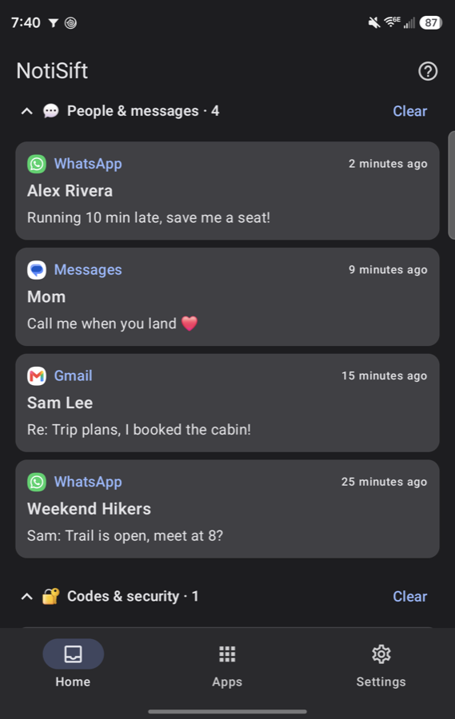
  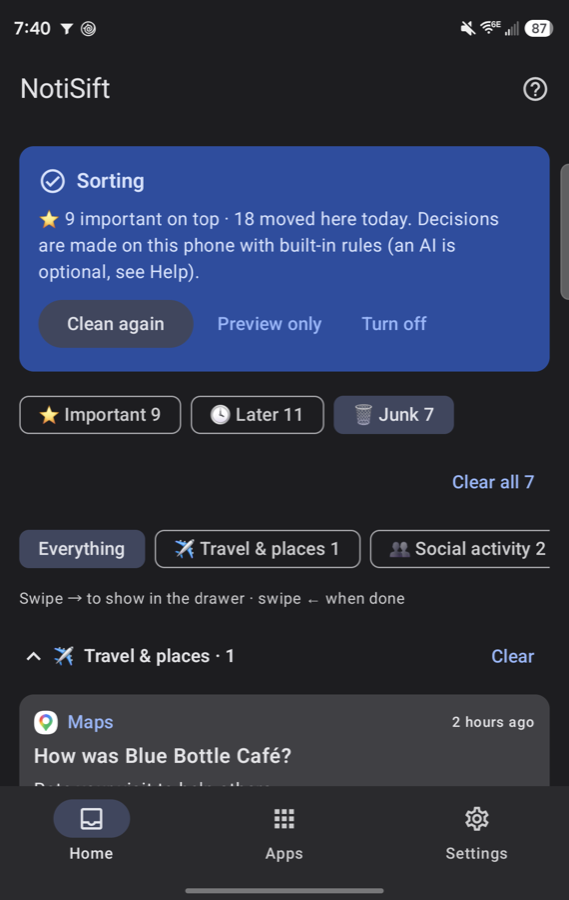
  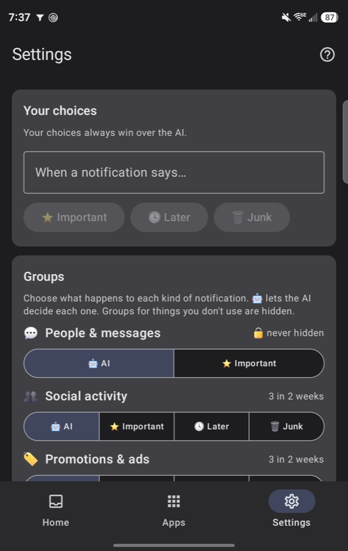
</p>

## What your drawer looks like

```
⭐ Important · 9              ← real copies of the originals: tap opens the exact chat,
   Alex Rivera   10:22           reply and other buttons work, swipe one away
   Team standup  10:18
   …
📌 Running in background · 2  ← car app, automation… tucked away; "Show" brings them back
18 waiting in NotiSift        ← silent, one row per group; tap to open, "Clear" to empty
   🏷️ Promotions & ads · 4
   📰 News, weather & sports · 2
   …
```

Or, with **By day** on, one stack per day that opens three levels deep:

```
🕓 Today · 16                 ← tap the stack: one row per group
   💬 People & messages · 5      ← expand a row (⌄): its newest notifications
   👥 Social activity · 3           Instagram: Sam liked your photo …
   ➕ More groups · 4             ← the small groups share one row: 📈 1 · ✈️ 1 · 📦 1 …
📅 Yesterday · 2
```

<p align="center">
  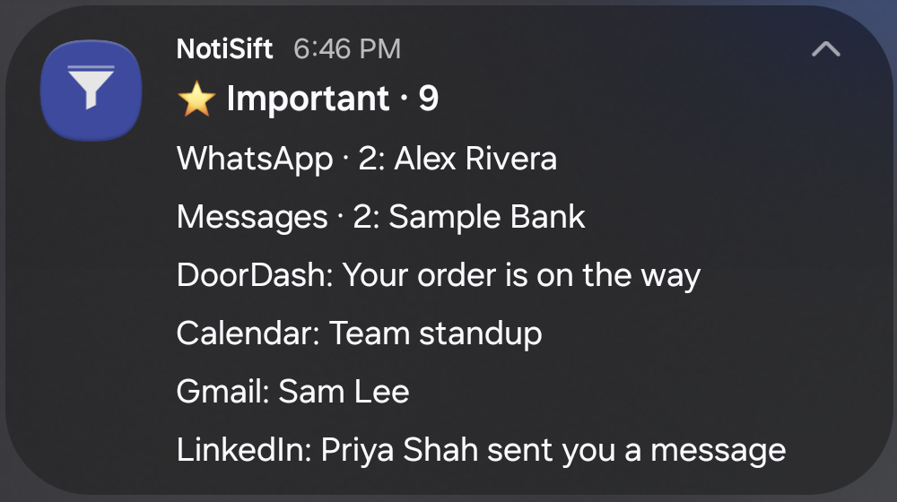
</p>
<sub>The demo's ⭐ Important stack in the real Android drawer: nine things that need you, nothing else.</sub>

Prefer dates? Tap **By day** on Home. The drawer then shows Today, Yesterday and an *Earlier* stack for the rest of
the week, so nothing drops out after a day. Inside each day the biggest groups get their own row and the small ones
share a *More groups* row, which keeps NotiSift well under Android's limit of about 50 notifications per app. The
Home tab mirrors it: day → group → notification, each level tap-to-open.

Calls, alarms, navigation, media, timers, downloads and Android's own system notices are never touched.

## Get started

### 1. Install

**Download:** get `NotiSift-<version>.apk` from the [latest release](https://github.com/procoder-net/notisift/releases/latest), open it on your phone, and allow your browser or file manager to install apps when Android asks. Android 8.0 or newer.

**Or build it yourself** (needs JDK 17+, Android Studio's bundled JBR works, and Android SDK 36):

```bash
git clone https://github.com/procoder-net/notisift.git && cd notisift
./gradlew :app:assembleRelease
adb install -r app/build/outputs/apk/release/app-release.apk
```

Your own builds are signed with the debug key unless you add a `keystore.properties` (see `app/build.gradle.kts`), so uninstall the downloaded app before installing one you built, and the other way round.

### 2. First run (about two minutes)

<p align="center">
  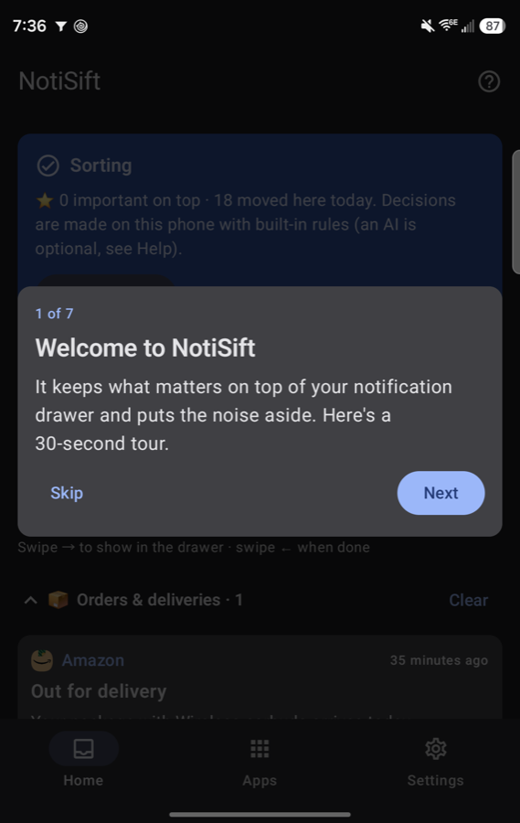
  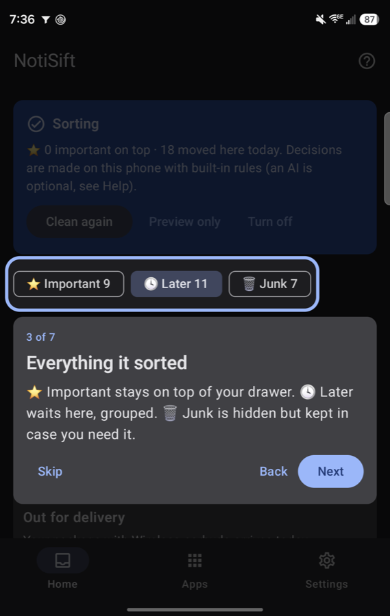
  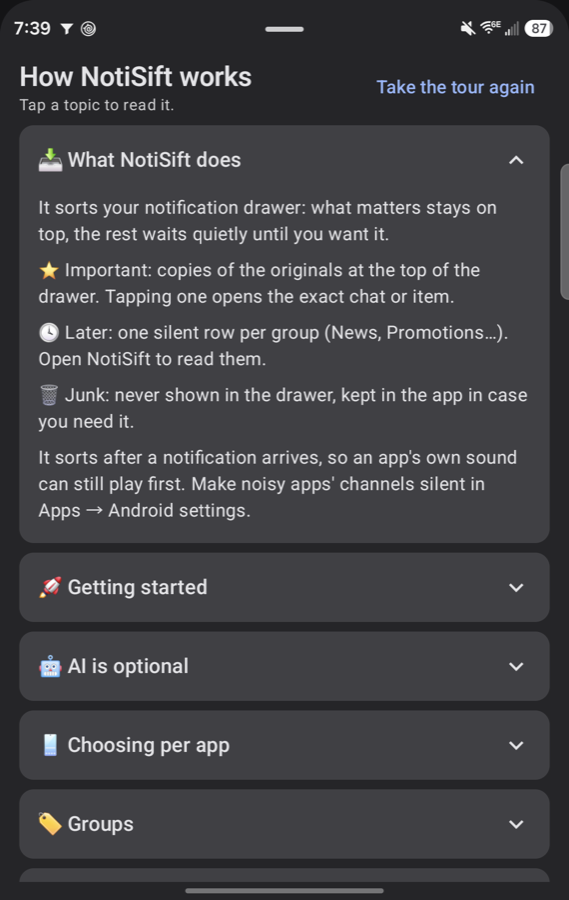
</p>

A 7-step guided tour runs the first time you open the app. The **?** button at the top opens Help over any
screen, with a short explanation of every part and *Take the tour again*.

The status card on Home always shows the one next step:

1. **Allow access.** Enable NotiSift under *Notification access*. This is how it reads notifications.
2. **Set up my apps.** A scan gives every installed app a starting choice. Most get 🤖 Smart; authenticator apps
   are always on top. It runs on the phone.
3. **Preview.** Use your phone normally for a day. Home shows what NotiSift *would* do; nothing moves yet.
   Swipe right on anything that should be Important, left on anything that's done.
4. **Start sorting.** Android asks to let NotiSift post its rows. From now on your drawer is sorted.
   Add the **NotiSift** Quick Settings tile to switch between sorting and Preview from the shade.

**Turn off** on the status card stops NotiSift completely: nothing is read, logged or sent anywhere.

### 3. Optional: add an AI model

Without a model NotiSift uses built-in rules on the phone, which already handle messages, codes, money, deliveries,
promos and app types. A model is better at the in-between cases ("is this Amazon notification a delivery or a deal?").

In the app: **Settings → Advanced**

| Field | What to put there |
|---|---|
| **Use AI** | On to use a model, off for on-phone rules only |
| **API key** | Any supported key. The provider is detected from the key itself |
| **Base URL / Model** | Leave blank for the provider's default; set them for Ollama, LM Studio or other OpenAI-compatible servers |
| **Tell the AI what matters to you** | Plain words, e.g. "school emails from Oak Elementary are important" |
| **Strictness** | How sure the AI must be before something goes to Junk |

Tap **Save & test**: it sends a sample promo and shows the verdict and how long it took. Keys are stored encrypted
with an Android Keystore key.

| Provider | Detected by | Notes |
|---|---|---|
| **Perplexity Decisions** (default) | `pplx-…`, `PERPLEXITY_API_KEY` | `POST /v1/decisions`, `pplx-decider-latest`. Real probabilities, ~0.3 s |
| Jev / FastJev | `api.typesafe.ai` / `:8000` | Same decision protocol (`/v1/systemone`) |
| Perplexity Agent | choose in Settings | Chat models via `/v1/agent`, no web search |
| OpenAI | `sk-…`, `api.openai.com` | Model auto-picked from `/models` if blank |
| Anthropic | `sk-ant-…` | Messages API |
| Google Gemini | `AIza…` | `generateContent` |
| OpenRouter / Groq | `sk-or-…` / `gsk_…` | OpenAI-compatible |
| Ollama / LM Studio | `:11434` / `:1234` | Local and private. Plain HTTP is allowed only for LAN/localhost hosts |
| Anything else | custom base URL | Any OpenAI-compatible `/chat/completions` server |

**Developers:** copy `.env.example` to `.env` (git-ignored) and fill in one key to pre-fill your own debug builds.

> The `.env` key is compiled into **debug** builds only. Release APKs never contain it unless you set
> `SIFT_EMBED_KEY_IN_RELEASE=true`; never share an APK built that way.

### 4. Tune it

| I want to… | Where |
|---|---|
| Always show / always hide one app | **Apps** → pick ⭐ Important, 🤖 Smart, 🕓 Later or 🗑️ Junk |
| Hide a kind of notification everywhere (e.g. all promos) | **Settings → Groups** → 🗑️ Junk on *Promotions & ads* |
| Catch a phrase ("flash sale", "your OTP") | **Settings → Your choices** → *When a notification says…* |
| Fix one mistake | **Home** → swipe right (on top) or left (done); *Undo* in the snackbar |
| Keep history shorter or longer | **Settings** → history retention, or *Delete notification history* |
| See everything by date instead of by group | **Home → By day** (the drawer switches too) |
| Quiet a busy group chat | Open one of its messages on **Home** → ⭐ Always on top / @ Only when mentioned / 🔕 Mute |
| Get @mentions through from muted groups | **Settings → Your choices** → *Names people @mention you by* |
| Pause for a while | Quick Settings tile, or **Preview only** on the status card |

Your choices always win over the AI. Protected groups (people, codes, money, calls) can be pinned on top but never hidden.

<p align="center">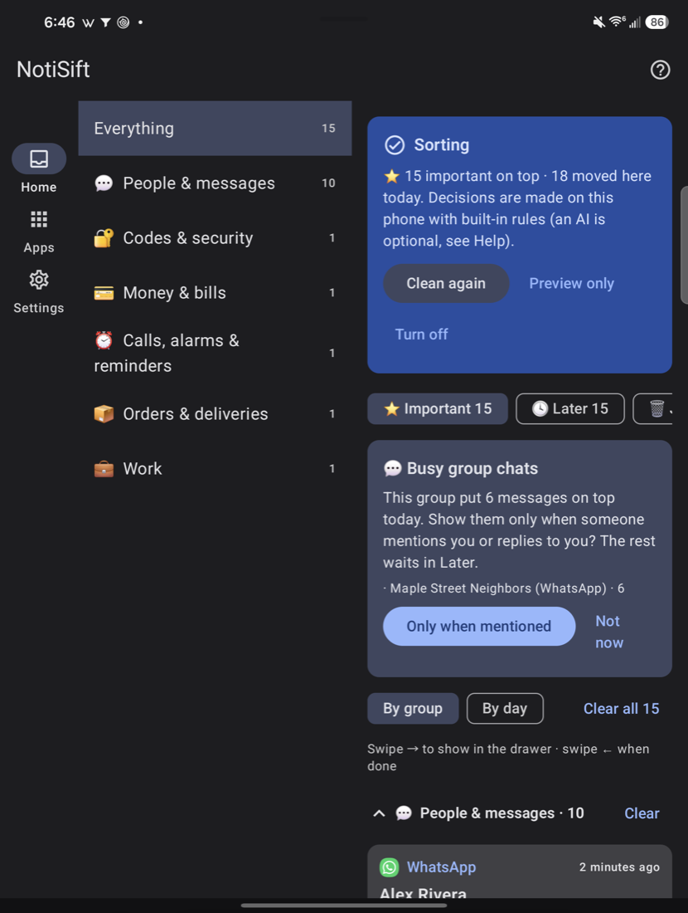</p>

## FAQ

**Does it delete my notifications?** No. Later and Junk are removed from the drawer but kept in NotiSift for the
retention period. You can put any of them back on top.

**Will it hide a code or a message from a person?** Not automatically. Those are protected and always stay on top,
whatever the model says. Only your own choice for a chat (Mute, or Only when mentioned) moves its messages to Later.

**Why did a notification still make a sound?** NotiSift sorts a notification right after Android posts it, so the
app's own sound can play first. For apps you mostly send to Later or Junk, make their channels silent in
*Apps → Android settings*; NotiSift still sees them.

**Does it need the internet?** Only if you add a cloud model. Built-in rules and Ollama/LM Studio work offline or on your LAN.

**What does the AI see?** The title and text of notifications that reach the model step, never codes, chats,
calls or ongoing notifications (see Privacy).

## How it works

### How a decision is made

Cheapest and safest first:

```
posted ─► live (call, alarm, media, navigation, progress, system)        ─► left alone
        ─► ongoing (car, automation, foreground service)                  ─► tucked into "Running"
        ─► verification code, message from a person, hidden by Android    ─► Important (protected)
        ─► your keyword rules  ("flash sale" → Junk)                      ─► as written
        ─► your app choice     (Important / Later / Junk)                 ─► as set
        ─► conversation or no readable text                               ─► Important / Later
        ─► duplicate within 10 min                                        ─► Junk
        ─► learned or corrected template                                  ─► cached answer
        ─► AI model, bursts batched (or offline heuristics if none)       ─► answer + group
        ─► your group choice   (Settings → Groups)                        ─► overrides
        ─► inbox mode: not clearly important                              ─► Later
        ─► safety net: codes, people, money and calls are never hidden automatically
```

New installs start in **Preview**: decisions are logged but nothing moves. Tap **Start sorting** on the Home
screen once you trust it. **Turn off** stops NotiSift completely: nothing is read, logged or sent to a model.

### How the drawer replacement works

Android doesn't let an app reorder another app's notifications, so NotiSift moves them:

1. **Important**: NotiSift rebuilds the original with `Notification.Builder.recoverBuilder` (so the tap target,
   reply and action buttons are the original app's own), posts it in its own "⭐ Important" group, and only then
   cancels the original. If posting fails, the original stays.
2. **Later / Junk**: the original is logged, then cancelled. Later items are summarised in one silent row per
   group.
3. **Running**: ongoing notifications can't be cancelled, so they are snoozed for an hour at a time and listed in
   the Running row.

Practical limits it works within:

- **About 5 posts per second per app.** Android silently drops the rest, so every post goes through a pacer
  (one every 350 ms), and summary rows are only re-posted when their content changes.
- **50 notifications per app.** At most 20 Important rows are shown; older ones stay in the app's Important tab.
- **Updates wipe NotiSift's notifications.** On reconnect it rebuilds the drawer from its log. The originals are
  gone by then, so rows rebuilt this way open the app instead of the exact chat. New messages bring the exact
  link back.
- **Drawers that sort by time** (One UI's default) would put a freshly refreshed waiting row above Important, so
  waiting rows carry an older timestamp. Not too old: Android silently drops notifications dated far in the past.

## Any decision model

Smart cleanup runs on one small contract, so any model can plug in:

```kotlin
interface DecisionModel {
    val id: String
    suspend fun decide(request: DecisionRequest): DecisionResult            // one decision
    suspend fun decideAll(requests: List<DecisionRequest>): List<DecisionResult> // optional batching
}
```

Decision APIs answer natively with probabilities. Chat models get the same requests as a JSON prompt.
Notifications arriving within 0.3 s of each other are decided in one call.

## Compatibility

| Android | Status |
|---|---|
| 8 – 9 (API 26–28) | Supported. Copies always use the app icon (icon types can't be read) |
| 10 – 13 | Supported |
| 14 | Supported. Swipeable foreground-service notifications (no "ongoing" flag) are still tucked away |
| 15 – 16 | Supported. Codes Android hides from listeners are left exactly as they are, because a copy would only show the placeholder (not yet verified on a device) |

- Notifications from work profiles and second users are left alone: NotiSift can only manage its own user's.
- Tested on Samsung One UI (Galaxy Z Fold). Samsung collapses each stack to one row; tap the count to expand it.
  Pixel shows the first few rows of a stack.

### Keep it running

Aggressive battery savers can stop the listener:

- **Samsung:** *Settings → Battery → Background usage limits → Never sleeping apps* → add NotiSift.
- **Xiaomi / HyperOS:** *App info → Battery saver → No restrictions*, and enable *Autostart*.
- **OnePlus / Oppo / Realme:** *App info → Battery → Allow background activity*.
- If the listener shows as off after an update, toggle NotiSift off and on in *Notification access*.

NotiSift moves a notification **after** it is posted, so its first sound or vibration can still play. For apps
you mostly send to Later or Junk, use *Apps → Android settings* to make that app's channels silent; NotiSift
still sees them.

## Privacy

- Everything is stored on the phone (Room + DataStore) and excluded from cloud backup and device transfer.
  *Settings → Delete notification history* removes it at any time; old history is deleted automatically.
- With a cloud model, the **title and text of notifications** that reach the model step are sent to that
  provider. The app scan sends app names, channel ids and a few notification titles, never from chats, codes,
  money or calls. Codes, conversations, calls, alarms and ongoing notifications are decided on the phone and never sent.
- Use Ollama or LM Studio on your LAN, or turn AI off, to keep everything local.
- Notification text is treated as untrusted. Prompts tell the model to ignore instructions inside it, and the
  answer is validated against a fixed set of actions and groups.

## Limitations

- Android doesn't let apps read other apps' notification channel lists, so the scan uses what NotiSift has
  observed. It improves the longer it runs.
- After NotiSift is updated or restarted by the system, rebuilt Important rows open the app rather than the
  exact chat (see above).
- `QUERY_ALL_PACKAGES` is used for the full app scan. Fine for sideloading and F-Droid; Google Play would need
  a justification.

## Project layout

```
app/src/main/java/io/github/notisift/
  llm/      Provider detection + one client for decision APIs and chat models
  engine/   Pipeline (DecisionEngine), groups, local rules, heuristics, prompts: no Android deps, unit-tested
  scan/     DeviceScanner (installed apps + observed history) and PolicyAdvisor (suggestions)
  service/  NotificationListenerService, Important stack, waiting groups, pacer
  data/     Room entities/DAO, settings, Room-backed engine store
  ui/       Compose screens: Home, Apps, Settings, Help sheet, first-run tour (adaptive for foldables)
  DemoData.kt  Invented notifications for the demo build
tools/testsender/   Helper app for end-to-end tests
scripts/            e2e-deeplink.sh
```


## Development

```bash
./gradlew :app:testDebugUnitTest :app:lintDebug   # unit tests + lint
./gradlew :app:assembleDebug                      # your own debug build (.env key included)
./gradlew :app:assembleDemo                       # demo build with made-up data, for screenshots
```

The **demo** build installs beside the real app as `io.github.notisift.demo`, fills itself with invented
notifications on first launch and never reads your drawer, so screenshots can't leak real messages.

### End-to-end tap test

`tools/testsender` is a tiny helper app that posts chat notifications whose tap opens one exact chat.
`scripts/e2e-deeplink.sh` posts one, checks that NotiSift's row carries the sender's own tap action, opens the
drawer, taps the row and confirms that exact chat opened:

```bash
./gradlew :testsender:installDebug
adb shell pm grant io.github.notisift.testsender android.permission.POST_NOTIFICATIONS
./scripts/e2e-deeplink.sh "Alice"     # phone unlocked, NotiSift turned on
```

### Releases

Pushing a `v*` tag runs [`.github/workflows/release.yml`](.github/workflows/release.yml): it tests, builds a
signed **APK** (for GitHub) and **AAB** (for Google Play), and attaches both to a GitHub release with their SHA-256.
Signing uses four repository secrets (`SIFT_KEYSTORE_BASE64`, `SIFT_KEYSTORE_STORE_PASSWORD`,
`SIFT_KEYSTORE_KEY_ALIAS`, `SIFT_KEYSTORE_KEY_PASSWORD`); without them the workflow stops rather than publish a
debug-signed build. Locally, put the same values in a gitignored `keystore.properties`
(`storeFile`, `storePassword`, `keyAlias`, `keyPassword`) and run `./gradlew :app:assembleRelease :app:bundleRelease`.

## Contributing

NotiSift gets better with every phone it runs on, and contributions are very welcome, no Android experience needed
for most of them:

- **🗂️ A notification landed in the wrong place?** [Open a "wrong sort" issue](https://github.com/procoder-net/notisift/issues/new?template=wrong-sort.yml)
  with the app, roughly what it said (no personal details) and where it should have gone. These become new rules
  and tests.
- **📱 Tested on a phone or launcher we haven't?** Tell us how the drawer looked: One UI, Pixel, MIUI, ColorOS,
  OxygenOS and others order stacks differently.
- **🤖 A decision model or provider we don't support?** Adding one is a small `DecisionModel` (see
  [Any decision model](#any-decision-model)).
- **🌍 Translations, accessibility, docs, screenshots** (demo build only, never real notifications).
- **🐛 Bugs and ideas:** [open an issue](https://github.com/procoder-net/notisift/issues/new/choose).

Read [CONTRIBUTING.md](CONTRIBUTING.md) for setup and the few rules (tests for engine changes, no secrets, no real
notification content in issues, screenshots or tests). Every change goes through a pull request; CI must pass and a
maintainer reviews and merges.

## Credits

Inspired by [notiq](https://github.com/chengyongru/notiq) (rule-guided remote decisions, observe first) and
[JevNoiseGate](https://github.com/ufec/jev-block-android-ad) (fail-open pipeline, local rules before models,
config-driven categories). Built and tested on a Galaxy Z Fold: the inner screen gets a navigation rail and
two-pane layouts.

## License

MIT
